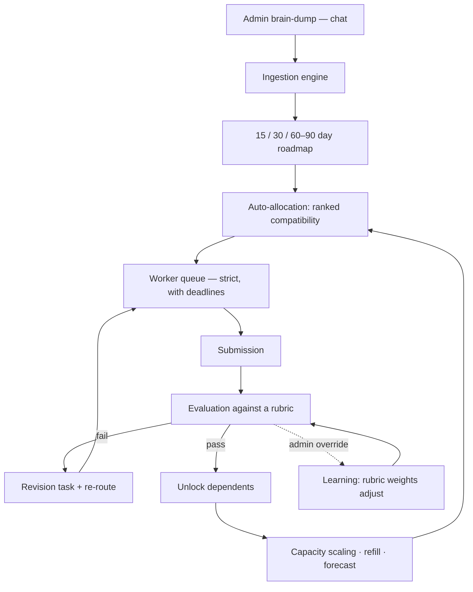

# AgencyOps

**A closed-loop AI operations engine for marketing agencies — an AI-COO that turns a brain-dump into a 90-day roadmap, routes work to the right specialist, grades every submission against a rubric, and heals the plan when something slips.**

[](https://nodejs.org)
[](https://expressjs.com)
[](https://www.postgresql.org)
[](https://www.prisma.io)
[](https://react.dev)
[](https://socket.io)
[](LICENSE)

---

## The problem

A small agency runs on the owner's head. Work arrives as a voice note or a Slack message, gets turned into a task list by hand, and is allocated to whoever is free rather than whoever is best. Quality is subjective, deadlines slip quietly, and nobody can answer *"why was this given to Bob?"* three weeks later.

AgencyOps replaces that with a loop the owner actually uses: **type what you want in a chat box, approve the plan, and the system runs the rest.**

## The loop



Nothing in that diagram needs a prompt from the admin. That is the point of the project.

---

## What is actually hard here

A CRUD app with an LLM bolted on is easy. The parts that took the work:

**1. It has to work when the model doesn't.** Every AI path has a deterministic fallback — ingestion, matching, evaluation, estimation. No API key, no balance, or a timeout, and the loop still closes. That is what makes it demoable and testable.

**2. Evaluation is a rubric, not a vibe.** A submission is graded on concrete criteria with explicit weights (deadline discipline is 20%). Grades carry evidence, so a worker can contest one and an admin can override it.

**3. Overrides are training data.** Repeated admin overrides shift the rubric weights in `learning.js`. The system converges on the house style instead of arguing with it forever.

**4. Every autonomous decision is recorded.** `AIDecisionAudit` and `AICostMonitor` exist because "the AI did it" is not an answer an agency owner accepts. Each decision stores its input, its output, its model, and its token cost.

**5. Routing is a ranking problem with real constraints.** Compatibility scoring combines capability, seniority, current queue depth, *effective* capacity (which drifts from quality and on-time history), and availability — then respects dependencies so a task cannot start before its blocker ships.

**6. Self-healing without loops.** A failed submission creates a revision task; a passed one unlocks dependents. Both need cycle protection, or a bad rubric produces infinite revisions.

**7. Memory that is scoped.** Product registry, conversations, and RAG memory are separate stores with separate retrieval rules — a client's product facts must not leak into another client's ranking prompt.

---

## Stack

| Layer | Technology |
|---|---|
| API | Node.js, Express, Socket.IO, node-cron |
| Data | PostgreSQL 16, Prisma (34 models, 6 migrations) |
| AI | DeepSeek via the OpenAI-compatible SDK, with deterministic fallbacks |
| Web | React 18, Vite, Tailwind, React Router |
| Auth | JWT access + refresh, bcrypt, rate limiting, session revocation |
| Mail | Nodemailer (digests, worker notifications), IMAP ingestion |

---

## Quick start

### With Docker

```bash
docker compose up --build
```

- Web — <http://localhost:5173>
- API — <http://localhost:4000>

Then apply migrations and seed demo data once the database is healthy:

```bash
docker compose exec api npx prisma migrate deploy
docker compose exec api npm run seed
```

### Without Docker

```bash
# 1. Database
createdb task_manager

# 2. API
cd backend
cp .env.example .env        # then set DATABASE_URL, JWT secrets, DEEPSEEK_API_KEY
npm install
npm run generate            # prisma client
npm run migrate             # apply migrations
npm run seed                # demo users + product
npm run dev                 # http://localhost:4000

# 3. Web (new terminal)
cd frontend
npm install
npm run dev                 # http://localhost:5173
```

The Vite dev server proxies `/api` and `/socket.io` to the API, so there is no CORS setup for local work. Under Compose it proxies to `api:4000` via `API_PROXY_TARGET`.

### Demo accounts (after `npm run seed`)

| Role | Email | Password |
|---|---|---|
| Admin | `admin@coo.app` | `admin123` |
| Worker | `alice@coo.app` | `worker123` |
| Worker | `bob@coo.app` | `worker123` |

Change them before exposing anything beyond localhost — `backend/scripts/setup-admin.mjs` sets a real admin.

---

## Configuration

All of it lives in `backend/.env` — see [`backend/.env.example`](backend/.env.example).

| Variable | Required | Purpose |
|---|---|---|
| `DATABASE_URL` | yes | PostgreSQL connection string |
| `JWT_SECRET`, `JWT_REFRESH_SECRET` | yes | Token signing — must be long and random in production |
| `DEEPSEEK_API_KEY` | no | Enables the AI engines; without it the deterministic fallbacks run |
| `DEEPSEEK_MODEL` / `_PRO_MODEL` / `_FLASH_MODEL` | no | Model routing; `MODEL_SELECTION=auto` sends planning to Pro and Q&A to Flash |
| `WEB_RESEARCH_ENABLED` | no | Keyless DuckDuckGo research during ingestion |
| `SMTP_*`, `DIGEST_EMAIL` | no | Daily/weekly digests and worker email |
| `FRONTEND_URL` | no | CORS origin |

---

## Repository layout

```
backend/
  prisma/schema.prisma      34 models — users, workers, tasks, evaluations, AI decisions…
  src/
    services/ai/            25 engines: ingestion, matching, evaluation, scaling,
                            auto-refill, self-healing, learning, memory, RAG, research…
    routes/                 30 REST modules
    jobs/cron.js            watchdog · digests · refill · forecast
    index.js                Express + Socket.IO bootstrap
frontend/
  src/pages/admin/          command dashboard, roadmaps, capability registry,
                            leaderboard, evaluation oversight, cost monitor
  src/pages/worker/         queue, task detail, performance
  src/pages/ai/             the chat surface the owner actually uses
  src/context/              auth + socket
docker-compose.yml          Postgres + API + web for local development
```

`FEATURES.md` is the full behavioural specification — every engine, trigger and edge case.

---

## Design decisions worth defending

- **Deterministic fallbacks everywhere.** An AI feature that only works when the vendor is up is a liability in a demo and a bug in production.
- **Deadlines are graded, not just displayed.** A countdown nobody is measured against is decoration.
- **Every write from the AI is attributed.** `AIDecisionAudit` is not telemetry; it is the audit trail an owner needs to trust the loop.
- **Capacity is derived, not declared.** A worker's effective capacity moves with their quality and on-time record, so routing self-corrects without an admin editing a number.
- **The owner's screen is a chat box.** Every extra form is a reason to stop using the product.

## License

[MIT](LICENSE)
